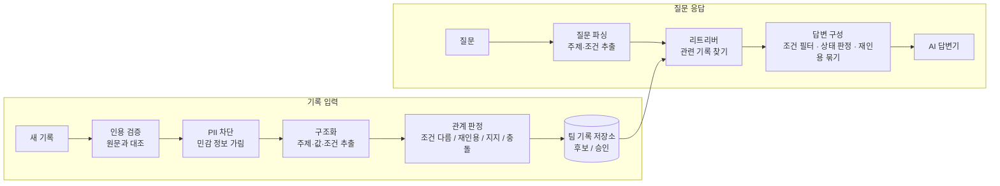
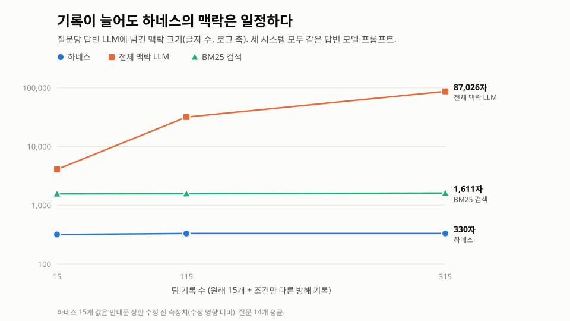

# knowledge_harness

**Evidence-Bounded Knowledge Harness**: 근거의 범위를 지키는 팀 지식 하네스

데이터분석캡스톤디자인 · TEAM YUSINESS (박재원, 정시찬)

> 처음 보는 사람을 위한 아주 쉬운 설명서(파일별, 코드 줄별 설명 포함)는 [docs/guide/](docs/guide/README.md)에 있다.

---

## 1. 무엇을 만드는가

### 문제

팀원마다 각자 AI를 쓰면서 실험 결과와 해석을 팀 기록에 공유한다. 그런데 공유되는 동안 문장이 원래 가졌던 **범위**가 사라진다.

- **조건이 사라진다.** "피처 12개, 데이터 v1에서 XGBoost가 가장 좋았다"가 어느새 "XGBoost가 가장 좋다"가 된다.
- **누가 말했는지가 사라진다.** AI가 올린 한 사람의 해석이 팀이 합의한 사실처럼 쓰인다.
- **근거가 부풀려진다.** 같은 실험 결과를 세 명이 다시 인용하면 근거가 세 개인 것처럼 보인다.
- **틀린 인용이 섞인다.** AI가 원문에 없는 숫자를 인용해도 아무도 확인하지 않는다.
- **민감 정보가 퍼진다.** 고객 전화번호나 API 키가 섞인 기록이 팀 전체와 외부 LLM으로 흘러간다.

### 해결

각자의 AI와 팀 기록 사이에 **하네스**(중간 관리 계층)를 둔다.

- **기록이 들어올 때:** 조건·작성자·근거를 붙여 저장한다. 인용이 원문과 맞는지 확인하고, 민감 정보를 가린다. 기존 기록과의 관계(조건이 다름, 재인용, 충돌)를 판정한다.
- **질문이 들어올 때:** 질문 조건에 맞는 기록만 골라 AI에게 넘긴다. "답할 수 있음 / 충돌 / 승인 전 후보뿐 / 근거 없음" 중 무엇인지 판정해서 함께 넘긴다.

목표는 **AI가 확실히 답할 수 있는 부분과 아닌 부분을 구분해서 답하게 하는 것**이다.

### 예시

팀 기록에는 "피처 12개, 데이터 v1에서 XGBoost가 가장 좋았다"(R01, 승인됨)가 있다. 누군가 이렇게 묻는다.

> **질문:** 피처 40개, 데이터 v1에서 이탈 예측 모델은 뭘 쓸까?

| | 답변 |
|---|---|
| 하네스 없이 (일반 검색 + AI) | "XGBoost가 가장 좋습니다." ← 피처 12개 실험을 40개 상황에 그대로 적용함 |
| 하네스 사용 | "피처 40개 조건에 맞는 팀 근거가 없습니다. R01(XGBoost)은 피처 12개 조건의 결과입니다." |

다른 예: 같은 조건에서 사람이 올린 승인 기록(XGBoost)과 AI가 올린 후보 기록(LightGBM)이 엇갈린다. 이때 하네스는 한쪽을 고르지 않고 **"충돌, 팀 검토 필요"**라고 답한다. 각 근거와 작성자도 함께 보여준다.

---

## 2. 어떻게 돌아가는가



| 모듈 | 파일 | 하는 일 | 모델 |
|---|---|---|---|
| 인용 검증 | `harness/verifier.py` | 인용 문장이 원문에 정말 있는지 확인. 숫자 하나만 바뀌어도 잡는다 | 규칙 (애매하면 큰 모델) |
| PII 차단 | `harness/pii.py` | 전화번호·이메일·주민번호·API 키·실명을 가린다 | 정규식 + 작은 모델 |
| 구조화 | `harness/llm.py` | 자유 문장 기록에서 주제·값·조건을 뽑는다 | 작은 모델 |
| 관계 판정 | `harness/relation.py` | 새 기록과 기존 기록의 관계를 정한다 | 규칙 |
| 저장소 | `harness/store.py` | 기록을 저장하고, 충돌이면 양쪽 모두에 검토 요청 표시 | - |
| 리트리버 | `harness/retriever.py` | 질문과 관련된 기록을 찾는다 (주제 일치 → BM25) | - |
| 답변 구성 | `harness/answer.py` | 조건 필터, 상태 판정, 재인용 묶기, 안내문 작성 | 규칙 |
| 파이프라인 | `harness/pipeline.py` | 위 모듈을 순서대로 연결한다 | - |

---

## 3. 폴더 구조

```
knowledge_harness/
├── harness/              ← 우리가 만든 시스템 본체
│   ├── schema.py         데이터 모양 정의 (기록, 근거, 질문, 답변)
│   ├── conditions.py     조건 비교 규칙
│   ├── verifier.py       인용 검증
│   ├── pii.py            민감 정보 차단
│   ├── relation.py       기록 사이 관계 판정
│   ├── store.py          팀 기록 저장소
│   ├── retriever.py      관련 기록 검색 (BM25 직접 구현)
│   ├── answer.py         답변 구성 (상태 판정)
│   ├── context.py        AI 답변기에 넘길 맥락 만들기
│   ├── llm.py            LLM 연결 (OpenAI 기본, Claude 선택), 캐시
│   └── pipeline.py       전체 흐름 (Harness 클래스)
├── baselines/            ← 비교 대상
│   ├── retrieval_only.py     일반 검색(BM25) 방식
│   ├── full_context_llm.py   기록 전부를 AI에 넣는 방식
│   └── graphiti_baseline.py  Graphiti (스트롱 베이스라인)
├── eval/                 ← 평가
│   ├── metrics.py        채점 기준
│   ├── run_eval.py       실험 실행 (여기서 시작)
│   └── scale.py          규모 실험용 방해 기록 생성
├── data/                 ← 실험 데이터 (직접 만든 합성 데이터)
│   ├── sources/          실험 원문 문서 10개 (exp_001 ~ exp_010)
│   ├── records.json      팀 기록 15개 (함정 포함)
│   └── queries.json      질문 14개 + 정답
├── scripts/              ← 보조 도구
│   ├── graphiti_smoke.py Graphiti 연결 확인
│   └── plot_scale.py     결과 그래프 그리기
├── tests/                ← 자동 테스트 (12개)
└── docs/                 ← 문서
    ├── guide/            쉬운 설명서 (파일별·코드별 해설)
    ├── design.md         설계 문서
    ├── experiments.md    실험 기록과 해석
    ├── meeting2.md       2차 멘토링 발표 흐름
    ├── timeline.md       일정
    └── figures/          그래프
```

### 폴더끼리 어떻게 연결되나

1. `eval/run_eval.py`가 시작점이다. `data/`에서 기록과 질문을 읽는다.
2. 비교할 시스템을 만든다. 우리 시스템은 `harness/`, 비교 대상은 `baselines/`에 있다.
3. 각 시스템에 기록을 모두 넣은 뒤, 질문을 하나씩 던진다.
4. 모든 시스템은 같은 모양의 답(`Response`)을 돌려준다. `eval/metrics.py`가 그 답을 정답과 비교해 채점한다.
5. 결과 표를 화면에 찍고, 질문별 상세 결과는 `results/`에 JSON으로 저장한다.

---

## 4. 실행

Python 3.10 이상이 필요하다. 기본 모드는 외부 패키지 없이 돌아간다.

```bash
python -m eval.run_eval -v      # rule 모드: 하네스 vs 일반 검색 + 모듈 끄기 실험
python -m pytest -q tests       # 테스트 (pytest 필요)
```

### 두 가지 평가 모드

| 모드 | 하네스가 받는 것 | 답하는 방식 | 용도 |
|---|---|---|---|
| `rule` (기본) | 정답 구조(주제·조건)를 미리 받음 | 템플릿 | 모듈이 제대로 도는지 확인, 오프라인 |
| `llm` | **자유 문장 기록과 질문 문장만** | **모든 시스템이 같은 LLM 답변기** | 베이스라인과 공정 비교 |

`llm` 모드에서는 모든 시스템이 같은 원재료를 받고, 같은 모델·같은 프롬프트로 답한다. 그래서 결과 차이는 AI에게 무엇을 넘겼는지(기억 계층)에서만 생긴다.

```bash
python3 -m venv .venv && source .venv/bin/activate   # Windows Git Bash: source .venv/Scripts/activate
python -m pip install -r requirements.txt
export OPENAI_API_KEY=sk-...
python -m eval.run_eval --answerer llm --systems retrieval_only,full_context_llm,harness --no-ablation -v
python -m eval.run_eval --answerer llm --scale 300 --systems retrieval_only,full_context_llm,harness --no-ablation
```

- 기본 모델은 Graphiti 기본값과 같은 `gpt-6-luna`다. `HARNESS_ANSWER_MODEL`, `HARNESS_SMALL_MODEL`로 바꿀 수 있다.
- LLM 응답은 `.cache/llm_cache.json`에 저장된다. 다시 돌리면 저장된 응답을 재사용해 비용이 들지 않는다.
- `--scale N`은 주제와 문장은 비슷하지만 조건이 다른 방해 기록 N개를 섞는다. 정답은 그대로 유효하다.
- Graphiti는 Neo4j와 `NEO4J_URI`, `NEO4J_USER`, `NEO4J_PASSWORD` 환경변수가 필요하다. 먼저 `python -m scripts.graphiti_smoke`로 연결을 확인한다.

---

## 5. 지금까지의 결과

### 공정 비교 + 규모 실험 (`llm` 모드, 질문 14개)

| 기록 수 | 지표 | 일반 검색 | 전체 맥락 LLM | Graphiti | **하네스** |
|---|---|---|---|---|---|
| 15 | 조건 일치 답변률 | 1.00 | 1.00 | (0.36*) | **1.00** |
| 115 | 조건 일치 답변률 | 0.93 | 0.86 | 0.36 | **1.00** |
| 315 | 조건 일치 답변률 | 0.93 | 0.93 | – | **1.00** |
| 315 | 질문당 맥락 글자 수 | 1,611 | 87,026 | 354 (115개) | **330** |
| 315 | 민감 정보 (맥락 / 답변) | 0.64 / 0.00 | 1.00 / 0.07 | 0.14 / 0.07 (115개) | **0.00 / 0.00** |

\* 질문 3개를 수정하기 전에 측정한 값이다.



**해석**
- **효율:** 하네스는 기록이 늘어도 맥락 크기가 일정하다. 기록 315개에서 전체 맥락 방식의 약 0.4%만 쓴다.
- **민감 정보:** 하네스만 모든 규모에서 맥락에도 답변에도 민감 정보를 내보내지 않았다.
- **Graphiti:** 기록을 사실로 요약하면서 조건·승인 상태·작성자 정보를 잃었다. 그래서 0.36에 그쳤다.
- **정확도:** 하네스는 모든 규모에서 1.00이다. 다만 베이스라인과의 차이가 1~2문항이라, 정확도에서 크게 이긴다고 주장하지 않는다.
- **데이터 한계:** 직접 만든 합성 데이터이고 질문이 14개뿐이다. 실제 팀 로그로 확장하는 것이 다음 단계다.

자세한 해석과 주의점은 [docs/experiments.md](docs/experiments.md)에 있다.

---

## 6. 문서

| 문서 | 내용 |
|---|---|
| [docs/guide/](docs/guide/README.md) | **처음 보는 사람용 쉬운 설명서**: 계기, 용어, 파일별·코드별 해설, 실험 해석 |
| [docs/design.md](docs/design.md) | 모듈 설계, 베이스라인 선정 이유, 메트릭, 효율성 설계, 열린 질문 |
| [docs/experiments.md](docs/experiments.md) | 1~3차 실험 결과와 해석, 주의점 |
| [docs/meeting2.md](docs/meeting2.md) | 2차 멘토링 발표 흐름 |
| [docs/timeline.md](docs/timeline.md) | 일정 |
