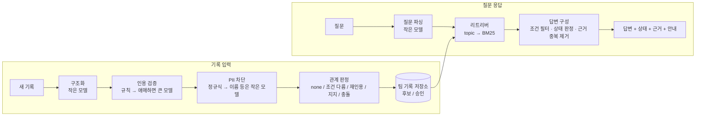

# knowledge_harness

**Evidence-Bounded Knowledge Harness** — 데이터분석캡스톤디자인, TEAM YUSINESS (박재원, 정시찬)

## 지식 기반 팀 실험 시스템

공유된 문장이라는 이유만으로 근거의 강도나 승인 범위가 늘어나면 안 된다.
이 하네스는 각자의 AI와 팀 기록 사이에 들어가서 다음 두 가지를 한다.

- 주장을 올릴 때 조건·작성 주체·근거를 붙여 기록한다.
- 팀 주장으로의 승격(합의)을 별도 상태로 관리한다.

질문이 들어오면 **답할 수 있는 부분과 없는 부분을 구분해서** 답한다.

## 모듈 구성



| 모듈 | 파일 | 입력 → 출력 | 모델 |
|---|---|---|---|
| 구조화 | `harness/llm.py` `structure_record` | 자유 텍스트 기록 → topic·value·conditions·quote | 작은 모델 (선택) |
| 인용 검증 | `harness/verifier.py` | 근거(원문·버전·구간) → 맞음/틀림 | 규칙 기반 + 애매 구간만 큰 모델 |
| PII 차단 | `harness/pii.py` | 기록 → 민감 정보를 가린 공유용 사본 | 정규식 + 형식 없는 정보는 작은 모델 (선택) |
| 관계 판정 | `harness/relation.py` | 새 기록 + 기존 기록 → 관계 | 규칙 기반 |
| 저장소 | `harness/store.py` | 기록 → 저장, 충돌 시 검토 요청 표시 | - |
| 리트리버 | `harness/retriever.py` | 질문 → 후보 기록 | BM25 (임베딩으로 교체 가능) |
| 답변 구성 | `harness/answer.py` | 질문 + 후보 → 상태·근거·안내 | 템플릿 (LLM 문장화는 TODO) |

자세한 설계는 [docs/design.md](docs/design.md)를, 일정은 [docs/timeline.md](docs/timeline.md)를 참고한다.

## 실행

평가는 두 가지 모드로 돌린다.

| 모드 | 하네스 입력 | 답변 | 용도 |
|---|---|---|---|
| `rule` (기본) | 정답 구조(topic·조건)를 받음 | 템플릿 | 모듈 개발, ablation. 오프라인 |
| `llm` | **자유 텍스트 기록 + 질문 문장만** (구조화·질문 파싱도 LLM으로 직접) | **모든 시스템이 같은 LLM 답변기** | 베이스라인과 공정 비교 |

`llm` 모드에서는 모든 시스템이 같은 원재료(기록 원본 + 인용한 원문 문서)를 받는다.
답변도 같은 프롬프트, 같은 모델로 한다. 그래서 결과 차이는 답변기에 넘기는 맥락, 즉 기억 계층에서만 생긴다.

```bash
python -m eval.run_eval -v      # rule 모드: 하네스 vs 약한 베이스라인 + ablation (의존성 없음)
python -m pytest -q tests       # 단위 테스트 (pytest 필요)
```

`llm` 모드와 Graphiti는 가상환경에 패키지를 설치하고 `OPENAI_API_KEY`를 설정해야 한다.

```bash
python3 -m venv .venv && source .venv/bin/activate   # Windows Git Bash: source .venv/Scripts/activate
python -m pip install -r requirements.txt
python -m eval.run_eval --answerer llm --systems retrieval_only,full_context_llm,harness --no-ablation -v
python -m eval.run_eval --answerer llm --systems retrieval_only,full_context_llm,harness,graphiti --no-ablation -v
```

- 기본 모델은 Graphiti 기본값과 같은 `gpt-6-luna`다. `HARNESS_ANSWER_MODEL`, `HARNESS_SMALL_MODEL`로 바꿀 수 있다.
- LLM 응답은 `.cache/llm_cache.json`에 캐시되어 다시 돌려도 비용이 들지 않는다.
- Graphiti는 Neo4j 접속 정보를 환경변수(`NEO4J_URI`, `NEO4J_USER`, `NEO4J_PASSWORD`)로 받는다. 먼저 `python -m scripts.graphiti_smoke`로 연결을 확인한다.
- 결과는 `results/<system>[-llm].json`에 질문별로 저장된다.

## 현재 결과

### rule 모드 (모듈 동작 확인용, 합성 데이터 14문항)

| system | condition_match ↑ | status_acc ↑ | overgeneralization ↓ | irrelevant_used ↓ | false_consensus ↓ | bad_citation_used ↓ | evidence_error ↓ | pii_leak ↓ |
|---|---|---|---|---|---|---|---|---|
| retrieval_only | 0.00 | 0.43 | 0.71 | 0.93 | 1.00 | 0.14 | 2.21 | 0.14 |
| **harness** | 1.00 | 1.00 | 0.00 | 0.00 | 0.00 | 0.00 | 0.00 | 0.07 |
| harness − 조건 비교 | 0.29 | 0.36 | 0.71 | 0.00 | 0.00 | 0.00 | 1.00 | 0.07 |
| harness − 인용 검증 | 0.93 | 0.93 | 0.00 | 0.00 | 0.00 | 0.07 | 0.07 | 0.07 |
| harness − 재인용 묶기 | 1.00 | 1.00 | 0.00 | 0.00 | 0.00 | 0.00 | 0.21 | 0.07 |
| harness − 승인 상태 | 0.79 | 0.79 | 0.00 | 0.00 | 0.36 | 0.00 | 0.00 | 0.07 |
| harness − PII 차단 | 1.00 | 1.00 | 0.00 | 0.00 | 0.00 | 0.00 | 0.00 | 0.14 |

> **주의.** rule 모드의 하네스는 정답 구조를 받으므로 1.00은 성능 주장이 아니다.
> 이 표는 각 모듈을 끄면 어느 메트릭이 나빠지는지만 보여준다.
> rule 모드의 PII 차단은 정규식만 써서 고객 실명은 못 가린다(pii_leak 0.07). llm 모드에서는 작은 모델로 실명도 찾는다.

### llm 모드 (공정 비교)

아직 실행 전이다. Graphiti 1차 실행 결과와 거기서 발견한 사례는 [docs/experiments.md](docs/experiments.md)에 있다.

## 디렉터리

```
harness/      하네스 모듈
baselines/    retrieval_only(약한), full_context_llm(LLM에 표로 넣기), graphiti(스트롱)
eval/         메트릭과 평가 스크립트
data/         sources/(실험 원문), records.json(팀 기록), queries.json(질문 + 정답)
docs/         설계, 일정
tests/        단위 테스트
```
