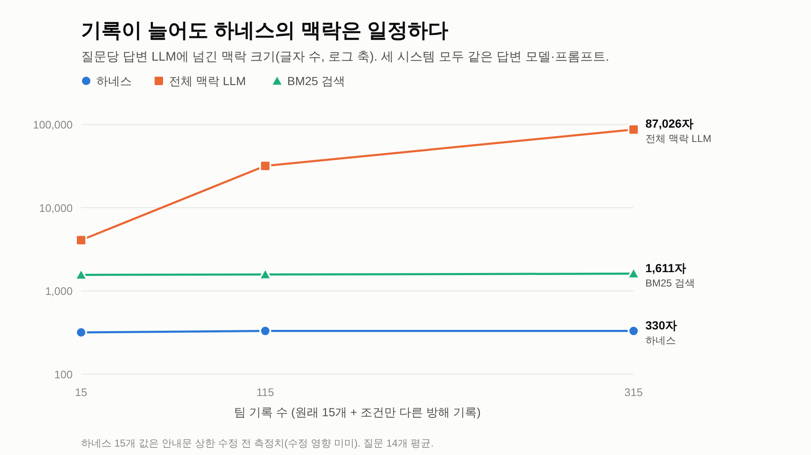

# 5편. 실험 결과 읽는 법

실험은 세 번에 걸쳐 진행했다. 매번 결과를 보고 "이 비교가 공정한가?"를 따졌고, 문제가 보이면 실험 방법을 고쳤다. 이 과정 자체가 중요한 결과다.

## 0. 점수 읽는 법

- 점수는 대부분 **0.00 ~ 1.00 사이의 비율**이다. 질문 14개 중 몇 개에서 그 일이 일어났는지를 뜻한다.
  - 1.00 = 14개 전부, 0.93 = 13개, 0.86 = 12개, 0.50 = 7개, 0.07 = 1개
- **질문 하나가 약 0.07(7%)**이다. 그래서 0.93과 1.00의 차이는 **딱 한 문항**이다. 이 정도 차이는 운일 수 있다.
- 좋은 방향:
  - `condition_match`(조건 일치 답변률), `status_acc`(상태 정답률)는 **높을수록** 좋다.
  - 나머지(실수, 민감 정보, 글자 수)는 **낮을수록** 좋다.
- 각 항목의 뜻은 [4편의 채점 기준표](04_baselines_eval_code.md#2-1-metricspy-채점-기준표)에 있다.

---

## 1차 실험: Graphiti를 처음 돌려봤다

### 한 것
Graphiti에 기록 15개를 넣고 질문 14개를 던졌다. Graphiti가 찾아준 사실 5개를 그대로 답으로 썼다.

### 결과

| 시스템 | 조건 일치 | 상태 정답 | 틀린 인용 사용 | 근거 수 오차 |
|---|---|---|---|---|
| 일반 검색 | 0.00 | 0.43 | 0.14 | 2.21 |
| 하네스 (정답 구조 받음) | 1.00 | 1.00 | 0.00 | 0.00 |
| Graphiti | 0.00 | 0.43 | 0.86 | 4.00 |

### "와, 압승!"이 아니었던 이유

숫자만 보면 하네스가 압승이다. 하지만 비교가 **공정하지 않았다.**

1. **Graphiti는 "근거 없음"이라고 말할 방법이 없었다.** Graphiti는 기억 저장소라서, 물어보면 항상 비슷한 사실을 돌려준다. 우리 연결 코드가 그걸 무조건 "답할 수 있음"으로 처리했다. 상태 정답 0.43은 정답이 원래 "답할 수 있음"인 6문항의 비율일 뿐이다.
2. **하네스만 정답 구조를 받았다.** 하네스는 주제와 조건을 정답 그대로 받았고, Graphiti는 글에서 직접 뽑아야 했다.
3. **근거 수 오차 4.00은 항상 사실 5개를 받아서 생긴 숫자다.** 재인용 판단과는 관계가 없었다.

### 그래도 건진 사례

AI가 잘못 옮긴 기록(R08, "learning rate 0.1")이 들어오자, Graphiti가 **올바른 기록(0.05)을 무효 처리**했다. 그 뒤로 "learning rate 얼마가 좋아?"에 0.1이라고 답했다.
- **하지만** 이 일은 2·3차 실험에서 다시 일어나지 않았다. Graphiti의 판단도 AI가 하는 거라 실행할 때마다 다를 수 있다.
- 그래서 발표에서는 **"한 번 관찰된 사례"**로만 소개한다.

---

## 2차 실험: 공정하게 다시

### 바꾼 것 (공정 비교 방식)
- **같은 재료:** 모든 시스템이 기록 원본(작성자, 승인 상태, 문장, 인용)과 원문만 받는다. 정답 조건은 누구에게도 주지 않는다. 하네스도 AI로 조건을 직접 뽑아야 한다.
- **같은 답변기:** 모든 시스템이 같은 AI 모델, 같은 지시문으로 답한다. 이제 Graphiti도 "근거 없음", "충돌"이라고 말할 수 있다.
- **비교 대상 추가:** "기록 전부를 AI에 넣기"(전체 맥락 LLM)를 추가했다. "그냥 다 넣어주면 되지 않나?"라는 질문에 답하기 위해서다.

이렇게 하면 결과 차이는 오직 **"AI에게 무엇을 넘겼나"**에서만 생긴다.

### 결과

| 시스템 | 조건 일치 | 민감 정보 (맥락에 포함) |
|---|---|---|
| 일반 검색 | 0.86 | 0.71 |
| 전체 맥락 LLM | 0.93 | 1.00 |
| **하네스** | **1.00** | **0.00** |
| Graphiti | 0.36 | 0.07 |

### 배운 것 1: 기록이 적으면 똑똑한 AI도 잘한다
- 일반 검색과 전체 맥락이 꽤 잘 맞혔다.
- 틀린 3문항을 열어보니 **우리 정답이 애매한** 문항이었다(2편 "정답을 고친 적이 있다" 참고). 그 3문항을 빼면 셋 다 전부 맞혔다.
- 이유는 두 가지다.
  - 기록 15개는 AI가 한 번에 다 읽고 비교할 수 있는 양이다.
  - 공정성을 위해 AI 지시문에 판단 규칙(조건 엄격히, 인용 확인, 재인용 묶기, 승인 구분)을 모두 적었다. 그래서 AI가 하네스가 하는 판단을 스스로 해냈다.
- **결론:** 정확도만으로는 하네스를 차별화하기 어렵다. 솔직하게 인정한다.

### 배운 것 2: Graphiti는 기록의 "꼬리표"를 잃어버린다
- Graphiti는 기록을 짧은 사실 문장으로 요약한다. 그 과정에서 **조건, 승인 상태, 작성자 정보가 대부분 사라졌다.**
  - 원래: "정시찬(사람) · 승인 · 피처 12개, v1 · XGBoost가 가장 좋다"
  - Graphiti 사실: "정시찬은 XGBoost를 가장 좋은 모델로 평가했으며, AUC는 0.842였다." ← 조건과 승인 여부가 없다
- 그래서 AI 답변기가 "조건이 맞는지 확인할 수 없다"며 "근거 없음"으로 답하는 경우가 많았다. 결과는 0.36이다.
- **가장 좋은 예 (Q02):**
  - R01(사람, 승인, XGBoost)의 사실에서는 조건이 사라졌다.
  - R04(AI, 승인 전, LightGBM)의 사실에는 "v1, 피처 12개"가 남았다.
  - 그 결과 AI가 **AI의 승인 전 의견을 팀 사실로 제시**했다. 정답은 "충돌"이다.
- 우리가 슬라이드에 적은 Graphiti의 약점 "작성 주체와 승인 상태 구분이 없음"이 실제로 확인된 장면이다.

### 배운 것 3: 민감 정보는 두 가지로 나눠 봐야 한다

| 시스템 | AI에게 넘긴 글에 포함 | 사용자에게 보인 답에 노출 |
|---|---|---|
| 일반 검색 | 14문항 중 10번 | **1번** ("대표 사례는 김민수(010-…)"라고 그대로 답함) |
| 전체 맥락 | 14번 전부 | 0번 |
| Graphiti | 1번 | 0번 |
| **하네스** | **0번** | **0번** |

- 전체 맥락 방식은 답변에서는 조심했다. 하지만 매 질문마다 **모든 민감 정보를 외부 AI 회사로 보냈다.**
- 이후 채점표를 "맥락 포함(`pii_in_context`)"과 "답변 노출(`pii_in_answer`)" 두 개로 나눴다.

---

## 3차 실험: 기록이 많아지면?

### 한 것
기록 15개에 비슷하지만 조건이 다른 방해 기록을 100개, 300개 섞었다. 방해 기록은 정답을 바꾸지 않는다(2편 4절).

### 결과 1: 정확도 (조건 일치 답변률)

| 기록 수 | 일반 검색 | 전체 맥락 | Graphiti | **하네스** |
|---|---|---|---|---|
| 15 | 1.00 | 1.00 | – | **1.00** |
| 115 | 0.93 | 0.86 | 0.36 | **1.00** |
| 315 | 0.93 | 0.93 | (안 돌림) | **1.00** |

- 하네스는 모든 규모에서 1.00이다.
- 다른 방식은 1~2문항씩 틀렸다. 다만 **전체 맥락은 1.00 → 0.86 → 0.93으로 오르락내리락**했다. 꾸준히 떨어진 게 아니다.
- **그래서 "기록이 많아지면 다른 방식은 정확도가 떨어진다"고 말할 수 없다.** 1~2문항 차이는 운의 범위다.
- 말할 수 있는 것은 **"하네스는 규모와 관계없이 정확도를 유지했다"**까지다.

### 결과 2: AI에게 넘긴 글의 양 (질문당 글자 수) — 가장 확실한 결과

| 기록 수 | 일반 검색 | 전체 맥락 | **하네스** |
|---|---|---|---|
| 15 | 1,558 | 4,078 | **317** |
| 115 | 1,575 | 31,801 | **330** |
| 315 | 1,611 | **87,026** | **330** |

- **전체 맥락**은 기록 수에 비례해서 계속 늘어난다. 기록 1,500개가 되면 질문 하나에 수십만 자를 넘겨야 한다. AI 비용은 넘기는 글의 양에 비례하니 그만큼 비싸고 느려진다.
- **하네스**는 기록이 20배 늘어도 **약 330자로 일정**하다. 질문 조건에 맞는 기록만 골라 넘기기 때문이다.
- 기록 315개 기준으로 하네스는 전체 맥락의 **약 0.4%(약 260분의 1)**만 쓴다.
- **중간에 고친 문제:**
  - 처음에는 하네스도 317 → 653 → 1,307자로 늘었다.
  - 원인을 찾아보니 "근거 없음"일 때 조건이 다른 기록을 **전부** 안내문에 나열하고 있었다. 기록 315개에서는 안내가 47줄이었다.
  - 가장 가까운 3개만 보여주도록 고쳤더니 330자로 일정해졌다(3편 ⑧-3).

### 결과 3: 민감 정보
모든 규모에서 **하네스만 0 / 0**이다.

### 결과 4: 기록을 넣는 데 드는 시간
- Graphiti는 기록 115개를 넣는 데 **24.4분**(기록당 약 12.7초) 걸렸다. 기록마다 AI를 여러 번 불러 사실을 뽑고 정리하기 때문이다.
- 하네스는 기록당 AI를 약 3번 부른다(구조화 1번 + 민감 정보 판정 2번). 다만 시간은 아직 정확히 재지 않았다. 다음에 할 일이다.

---

## 4. 모듈 끄기 실험 (rule 모드)

하네스의 부품을 하나씩 빼면 무엇이 나빠지는지 봤다. 각 부품이 **자기 일을 하고 있다**는 증거다.

| 뺀 부품 | 나빠진 점수 | 뜻 |
|---|---|---|
| 없음 (전부 켬) | 없음 (단, 민감 정보 0.07*) | |
| 조건 비교 | 조건 일치 0.29, 과잉 일반화 0.71 | 조건을 안 보면 피처 12개 결과를 40개 질문에 쓴다 |
| 인용 검증 | 틀린 인용 사용 0.07 | R08(0.1)이 근거로 들어가서 Q06이 "충돌"이 된다 |
| 재인용 묶기 | 근거 수 오차 0.21 | Q07에서 근거를 3개로 센다 |
| 승인 상태 | 잘못된 합의 0.36 | AI의 후보 의견을 팀 사실로 말한다 |
| PII 차단 | 민감 정보 0.07 → 0.14 | 전화번호·이메일·API 키까지 그대로 넘어간다 |

\* rule 모드는 AI 없이 정규식만 쓴다. 그래서 고객 실명(김민수)은 하네스도 못 가린다. llm 모드에서는 작은 AI 모델이 실명까지 찾아서 0.00이 된다.

부품 하나를 빼면 **그 부품이 맡은 점수만** 나빠진다. 부품끼리 일이 겹치지 않는다는 뜻이다.

---

## 5. 한 줄로 정리하면

> **하네스는 기록이 많아져도 같은 정확도를, 훨씬 적은 글(전체 맥락의 약 0.4%)로, 민감 정보 없이 낸다. Graphiti는 요약 과정에서 조건과 승인 정보를 잃어 정확도가 낮다.**

### 발표에서 조심할 것

| 말해도 되는 것 | 말하면 안 되는 것 |
|---|---|
| 하네스는 모든 규모에서 정확도 1.00을 유지했다 | 하네스가 정확도에서 크게 이긴다 |
| 하네스의 맥락은 일정하고, 전체 맥락은 기록 수에 비례해 커진다 | 기록이 많아지면 베이스라인 정확도가 떨어진다 |
| 하네스만 민감 정보를 내보내지 않았다 | Graphiti가 틀린 정보로 맞는 정보를 덮어쓴다 (한 번만 관찰됨) |
| Graphiti는 조건·승인 정보를 잃는다 (Q02 사례) | 실제 팀에서도 이렇게 된다 (아직 합성 데이터뿐) |

---

## 6. 한계와 다음 할 일

| 한계 | 다음 할 일 |
|---|---|
| 우리가 직접 만든 합성 데이터다. 함정을 만든 사람이 하네스도 만들었다 | 실제 팀 실험 로그로 데이터를 만든다. 기록을 쓰는 사람과 정답을 만드는 사람을 나눈다 |
| 질문이 14개뿐이라 1~2문항 차이는 운일 수 있다 | 관계 유형별로 질문을 10개 이상 만든다. seed를 바꿔 여러 번 돌린다 |
| 실명 판정에 외부 AI를 쓴다 | 컴퓨터 안에서 도는 작은 모델(로컬 NER)로 바꾼다 |
| 하네스의 기록 입력 시간을 재지 않았다 | 입력 시간과 AI 호출 비용을 측정해서 Graphiti와 비교한다 |
| 조건 이름을 2개(피처 수, 데이터 버전)로 고정했다 | 팀이 조건 이름을 어떻게 관리할지 정한다 |
| 승인은 누가, 어떻게 하는지 정하지 않았다 | 승인 절차를 설계한다 (투표, 리더, 근거 수 기준 등) |
